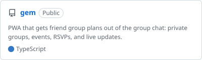
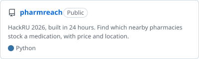
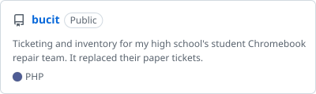
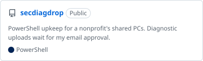
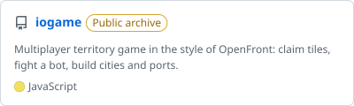
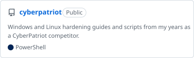
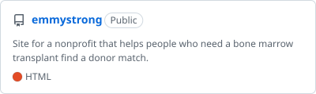

  

  <picture>
    <source media="(prefers-color-scheme: dark)" srcset="https://github-profile-summary-cards.vercel.app/api/cards/stats?username=aidanlenahan&theme=github_dark">
    
  </picture>

# Aidan Lenahan

Computer science student at Stevens Institute of Technology, class of 2030, from New Jersey.

Most of what I build is for people I know: a school repair team, two nonprofits, my friend group, and the clients of my dog walking business. Outside of that I play CTFs and run a Proxmox homelab.

## Projects

  <a href="https://github.com/aidanlenahan/gem"><picture><source media="(prefers-color-scheme: dark)" srcset="img/pins/gem-dark.svg"></picture></a>
  <a href="https://github.com/aidanlenahan/pharmreach"><picture><source media="(prefers-color-scheme: dark)" srcset="img/pins/pharmreach-dark.svg"></picture></a>

  <a href="https://github.com/aidanlenahan/bucit"><picture><source media="(prefers-color-scheme: dark)" srcset="img/pins/bucit-dark.svg"></picture></a>
  <a href="https://github.com/aidanlenahan/secdiagdrop"><picture><source media="(prefers-color-scheme: dark)" srcset="img/pins/secdiagdrop-dark.svg"></picture></a>

  <a href="https://github.com/aidanlenahan/iogame"><picture><source media="(prefers-color-scheme: dark)" srcset="img/pins/iogame-dark.svg"></picture></a>
  <a href="https://github.com/aidanlenahan/cyberpatriot"><picture><source media="(prefers-color-scheme: dark)" srcset="img/pins/cyberpatriot-dark.svg"></picture></a>

  <a href="https://github.com/aidanlenahan/emmystrong"><picture><source media="(prefers-color-scheme: dark)" srcset="img/pins/emmystrong-dark.svg"></picture></a>
  <a href="https://github.com/aidanlenahan/rbrgymnastics"><picture><source media="(prefers-color-scheme: dark)" srcset="img/pins/rbrgymnastics-dark.svg"></picture></a>

Live: [GEM](https://gem.aidanlenahan.com) · [PharmReach](https://pharmreach.tech) · [BucIT](https://bucit.alenahan.net) · [iogame demo](https://iogame.alenahan.net) · [CyberPatriot guides](https://cyberpatriot.alenahan.net) · [Emmy Strong](https://emmy-strong.org) · [Gymnastics Excellence Fund](https://rbrgymnastics.com)

Away from GitHub I run a Proxmox homelab (VMs, LXC containers, a NAS, Home Assistant, Ubiquiti networking) and built [door-triggered pantry lighting](https://aidanlenahan.com/blog/articles/pantry-lighting.html) from a reed switch and a 12V relay. Smaller projects live at [alenahan.net](https://alenahan.net).

## Work

- **Network and Cybersecurity Intern**, Family Resource Associates, 2024 to 2026. Managed group policy and DNS content filtering on 100+ devices and wrote secdiagdrop for their machines.
- **Advanced Cybersecurity Intern**, NJ Cybersecurity and Communications Integration Cell, 2025. Wrote CTFd challenges and a digital escape room for a statewide K-12 outreach program, then presented at Cyber Day.
- **Volunteer Web Developer** for the Gymnastics Excellence Fund and the Emmy Strong Foundation, 2025 to 2026.
- **Founder**, Aidan Lenahan Dog Services, 2021 to now. 60+ clients.

## Security

GIAC GFACT certified in 2024. I competed in CyberPatriot from elementary school through senior year and captained my high school team. I also play picoCTF, Garden State CTF, and others.

## Stack

**Languages:** Python, TypeScript, JavaScript, Java, PHP, SQL, PowerShell\
**Web:** React, Node.js, Fastify, Socket.IO, Tailwind, PostgreSQL, MySQL\
**Systems:** Linux, Windows Server, Proxmox, Docker, Apache, Pi-hole

## Contact

[aidanlenahan.com](https://aidanlenahan.com) · [LinkedIn](https://linkedin.com/in/aidanlenahan) · [Resume](https://aidanlenahan.com/files/Aidan_Lenahan_Resume.pdf)
